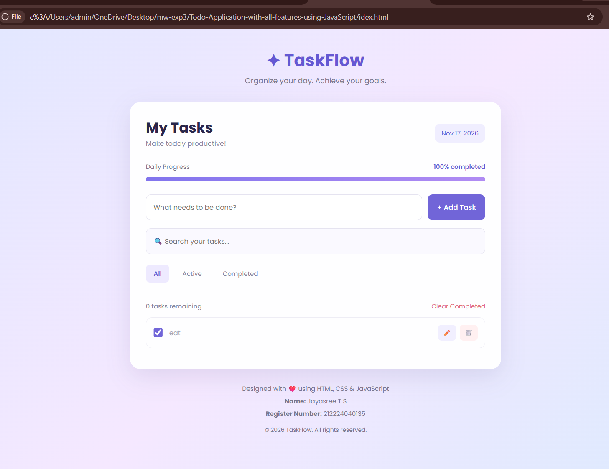
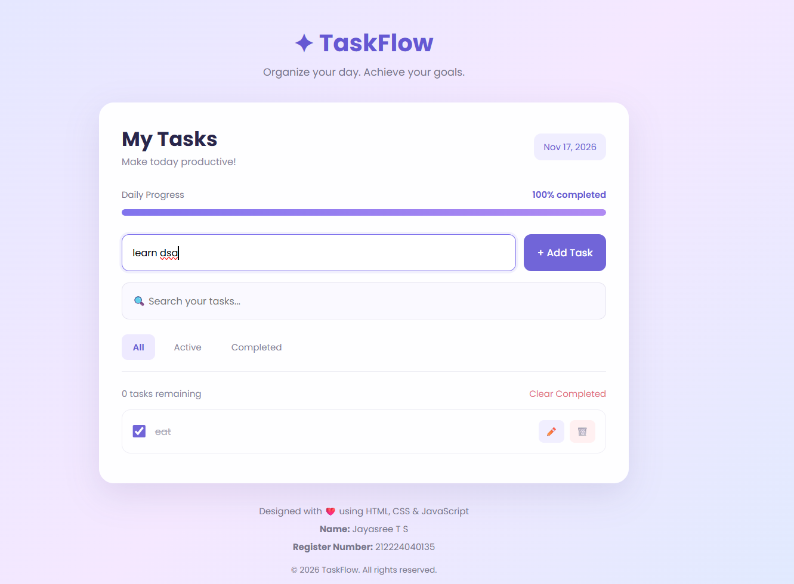
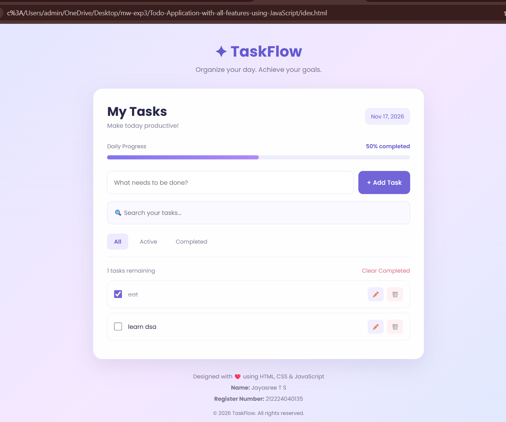

# Ex03 To-Do List using JavaScript
## Date: 17/11/16

## AIM
To create a To-do Application with all features using JavaScript.

## ALGORITHM
### STEP 1
Build the HTML structure (index.html).

### STEP 2
Style the App (style.css).

### STEP 3
Plan the features the To-Do App should have.

### STEP 4
Create a To-do application using Javascript.

### STEP 5
Add functionalities.

### STEP 6
Test the App.

### STEP 7
Open the HTML file in a browser to check layout and functionality.

### STEP 8
Fix styling issues and refine content placement.

### STEP 9
Deploy the website.

### STEP 10
Upload to GitHub Pages for free hosting.

## PROGRAM
index.html

```

<!DOCTYPE html>
<html lang="en">
<head>
    <meta charset="UTF-8">
    <meta name="viewport" content="width=device-width, initial-scale=1.0">
    <title>TaskFlow - Todo Application</title>
    <link rel="stylesheet" href="style.css">
</head>
<body>

    <div class="container">

        <header>
            <div class="logo">✦ TaskFlow</div>
            <p class="tagline">Organize your day. Achieve your goals.</p>
        </header>

        <main class="todo-card">

            <div class="welcome">
                <div>
                    <h1>My Tasks</h1>
                    <p>Make today productive!</p>
                </div>
                <div class="date" id="currentDate"></div>
            </div>

            <div class="progress-section">
                <div class="progress-info">
                    <span>Daily Progress</span>
                    <span id="progressText">0% completed</span>
                </div>
                <div class="progress-bar">
                    <div id="progressFill"></div>
                </div>
            </div>

            <form id="todoForm" class="input-section">
                <input
                    type="text"
                    id="todoInput"
                    placeholder="What needs to be done?"
                    autocomplete="off"
                >
                <button type="submit" id="addBtn">+ Add Task</button>
            </form>

            <div class="search-section">
                <input
                    type="text"
                    id="searchInput"
                    placeholder="🔍 Search your tasks..."
                >
            </div>

            <div class="filter-section">
                <button class="filter-btn active" data-filter="all">All</button>
                <button class="filter-btn" data-filter="active">Active</button>
                <button class="filter-btn" data-filter="completed">Completed</button>
            </div>

            <div class="task-summary">
                <span id="taskCount">0 tasks remaining</span>
                <button id="clearCompleted">Clear Completed</button>
            </div>

            <ul id="todoList"></ul>

            <div id="emptyMessage" class="empty-message">
                <div class="empty-icon">📝</div>
                <h3>No tasks yet!</h3>
                <p>Add a task above to get started.</p>
            </div>

        </main>

        <footer>
            <p>Designed with ❤️ using HTML, CSS & JavaScript</p>
            <p><strong>Name:</strong> YOUR NAME</p>
            <p><strong>Register Number:</strong> YOUR REGISTER NUMBER</p>
            <p class="copyright">© 2026 TaskFlow. All rights reserved.</p>
        </footer>

    </div>

    <script src="script.js"></script>
</body>
</html>

```

script.jss

```

const todoForm = document.getElementById("todoForm");
const todoInput = document.getElementById("todoInput");
const todoList = document.getElementById("todoList");
const searchInput = document.getElementById("searchInput");
const taskCount = document.getElementById("taskCount");
const emptyMessage = document.getElementById("emptyMessage");
const clearCompleted = document.getElementById("clearCompleted");
const progressFill = document.getElementById("progressFill");
const progressText = document.getElementById("progressText");
const addBtn = document.getElementById("addBtn");

let tasks = JSON.parse(localStorage.getItem("tasks")) || [];
let currentFilter = "all";
let editingId = null;

// Display current date
document.getElementById("currentDate").textContent =
    new Date().toLocaleDateString("en-US", {
        day: "numeric",
        month: "short",
        year: "numeric"
    });

// Save tasks in Local Storage
function saveTasks() {
    localStorage.setItem("tasks", JSON.stringify(tasks));
}

// Add a new task
todoForm.addEventListener("submit", function(event) {
    event.preventDefault();

    const taskText = todoInput.value.trim();

    if (taskText === "") {
        alert("Please enter a task!");
        return;
    }

    if (editingId !== null) {
        tasks = tasks.map(task =>
            task.id === editingId
                ? { ...task, text: taskText }
                : task
        );

        editingId = null;
        addBtn.textContent = "+ Add Task";
    } else {
        const newTask = {
            id: Date.now(),
            text: taskText,
            completed: false
        };

        tasks.push(newTask);
    }

    todoInput.value = "";
    saveTasks();
    renderTasks();
});

// Display tasks
function renderTasks() {
    todoList.innerHTML = "";

    const searchText = searchInput.value.toLowerCase();

    let filteredTasks = tasks.filter(task => {
        const matchesSearch = task.text.toLowerCase().includes(searchText);

        const matchesFilter =
            currentFilter === "all" ||
            (currentFilter === "active" && !task.completed) ||
            (currentFilter === "completed" && task.completed);

        return matchesSearch && matchesFilter;
    });

    filteredTasks.forEach(task => {
        const li = document.createElement("li");
        li.className = "task-item";

        if (task.completed) {
            li.classList.add("completed");
        }

        const checkbox = document.createElement("input");
        checkbox.type = "checkbox";
        checkbox.className = "task-checkbox";
        checkbox.checked = task.completed;

        checkbox.addEventListener("change", () => {
            toggleTask(task.id);
        });

        const span = document.createElement("span");
        span.className = "task-text";
        span.textContent = task.text;

        const actions = document.createElement("div");
        actions.className = "task-actions";

        const editButton = document.createElement("button");
        editButton.className = "action-btn edit-btn";
        editButton.textContent = "✏️";
        editButton.title = "Edit Task";

        editButton.addEventListener("click", () => {
            editTask(task.id);
        });

        const deleteButton = document.createElement("button");
        deleteButton.className = "action-btn delete-btn";
        deleteButton.textContent = "🗑️";
        deleteButton.title = "Delete Task";

        deleteButton.addEventListener("click", () => {
            deleteTask(task.id);
        });

        actions.appendChild(editButton);
        actions.appendChild(deleteButton);

        li.appendChild(checkbox);
        li.appendChild(span);
        li.appendChild(actions);

        todoList.appendChild(li);
    });

    // Show empty message when there are no visible tasks
    emptyMessage.style.display =
        filteredTasks.length === 0 ? "block" : "none";

    // Update remaining task count
    const remaining = tasks.filter(task => !task.completed).length;
    taskCount.textContent = `${remaining} tasks remaining`;

    // Update progress bar
    const completed = tasks.filter(task => task.completed).length;

    const progress = tasks.length === 0
        ? 0
        : Math.round((completed / tasks.length) * 100);

    progressFill.style.width = progress + "%";
    progressText.textContent = progress + "% completed";
}

// Complete or uncomplete a task
function toggleTask(id) {
    tasks = tasks.map(task =>
        task.id === id
            ? { ...task, completed: !task.completed }
            : task
    );

    saveTasks();
    renderTasks();
}

// Edit a task
function editTask(id) {
    const task = tasks.find(task => task.id === id);

    if (task) {
        todoInput.value = task.text;
        editingId = id;
        addBtn.textContent = "Update Task";
        todoInput.focus();
    }
}

// Delete a task
function deleteTask(id) {
    if (confirm("Are you sure you want to delete this task?")) {
        tasks = tasks.filter(task => task.id !== id);

        if (editingId === id) {
            editingId = null;
            todoInput.value = "";
            addBtn.textContent = "+ Add Task";
        }

        saveTasks();
        renderTasks();
    }
}

// Clear all completed tasks
clearCompleted.addEventListener("click", function() {
    tasks = tasks.filter(task => !task.completed);
    saveTasks();
    renderTasks();
});

// Filter tasks
document.querySelectorAll(".filter-btn").forEach(button => {
    button.addEventListener("click", function() {
        document.querySelectorAll(".filter-btn").forEach(btn => {
            btn.classList.remove("active");
        });

        this.classList.add("active");
        currentFilter = this.dataset.filter;

        renderTasks();
    });
});

// Search tasks
searchInput.addEventListener("input", renderTasks);

// Load saved tasks when page opens
renderTasks();

```

style.css

```

@import url('https://fonts.googleapis.com/css2?family=Poppins:wght@300;400;500;600;700&display=swap');

* {
    margin: 0;
    padding: 0;
    box-sizing: border-box;
}

body {
    font-family: 'Poppins', sans-serif;
    background: linear-gradient(135deg, #e0e7ff, #f5e8ff, #dbeafe);
    min-height: 100vh;
    color: #252542;
}

.container {
    width: 100%;
    max-width: 750px;
    margin: auto;
    padding: 35px 20px;
}

header {
    text-align: center;
    margin-bottom: 30px;
}

.logo {
    font-size: 32px;
    font-weight: 700;
    color: #6558d3;
}

.tagline {
    color: #77758c;
    font-size: 14px;
    margin-top: 5px;
}

.todo-card {
    background: rgba(255, 255, 255, 0.95);
    padding: 30px;
    border-radius: 20px;
    box-shadow: 0 15px 45px rgba(65, 55, 120, 0.12);
}

.welcome {
    display: flex;
    justify-content: space-between;
    align-items: center;
    margin-bottom: 25px;
}

.welcome h1 {
    font-size: 27px;
    color: #29264b;
}

.welcome p {
    color: #88869c;
    font-size: 13px;
}

.date {
    font-size: 12px;
    color: #6558d3;
    background: #f0eeff;
    padding: 9px 13px;
    border-radius: 10px;
}

.progress-section {
    margin-bottom: 25px;
}

.progress-info {
    display: flex;
    justify-content: space-between;
    font-size: 12px;
    margin-bottom: 10px;
    color: #77758c;
}

#progressText {
    color: #6558d3;
    font-weight: 600;
}

.progress-bar {
    height: 9px;
    background: #eeedfa;
    border-radius: 20px;
    overflow: hidden;
}

#progressFill {
    height: 100%;
    width: 0%;
    background: linear-gradient(90deg, #8174ed, #b08bf3);
    border-radius: 20px;
    transition: width 0.3s ease;
}

.input-section {
    display: flex;
    gap: 10px;
    margin-bottom: 15px;
}

.input-section input,
.search-section input {
    flex: 1;
    min-width: 0;
    padding: 14px;
    border: 1px solid #e5e3f0;
    border-radius: 10px;
    outline: none;
    font-family: inherit;
    font-size: 13px;
}

input:focus {
    border-color: #8174ed;
    box-shadow: 0 0 0 3px rgba(129, 116, 237, 0.1);
}

#addBtn {
    background: #7165d8;
    color: white;
    border: none;
    border-radius: 10px;
    padding: 12px 18px;
    font-family: inherit;
    cursor: pointer;
    font-weight: 500;
    transition: 0.3s;
}

#addBtn:hover {
    background: #5145bd;
    transform: translateY(-2px);
}

.search-section {
    margin-bottom: 20px;
}

.search-section input {
    width: 100%;
    background: #faf9ff;
}

.filter-section {
    display: flex;
    gap: 10px;
    border-bottom: 1px solid #eeeef4;
    padding-bottom: 15px;
}

.filter-btn {
    background: transparent;
    border: none;
    color: #858398;
    padding: 8px 15px;
    border-radius: 8px;
    font-family: inherit;
    cursor: pointer;
    font-size: 12px;
    transition: 0.3s;
}

.filter-btn.active,
.filter-btn:hover {
    background: #eeeaff;
    color: #6558d3;
    font-weight: 600;
}

.task-summary {
    display: flex;
    justify-content: space-between;
    align-items: center;
    margin: 20px 0 12px;
    font-size: 12px;
    color: #858398;
}

#clearCompleted {
    background: none;
    border: none;
    color: #e16c7d;
    cursor: pointer;
    font-family: inherit;
    font-size: 12px;
}

#clearCompleted:hover {
    text-decoration: underline;
}

#todoList {
    list-style: none;
}

.task-item {
    display: flex;
    align-items: center;
    gap: 12px;
    padding: 14px;
    border: 1px solid #eeedf5;
    border-radius: 12px;
    margin-bottom: 10px;
    transition: 0.2s;
    animation: appear 0.3s ease;
}

.task-item:hover {
    border-color: #c7c0f5;
    background: #fcfbff;
}

@keyframes appear {
    from {
        opacity: 0;
        transform: translateY(8px);
    }
    to {
        opacity: 1;
        transform: translateY(0);
    }
}

.task-checkbox {
    width: 18px;
    height: 18px;
    accent-color: #7165d8;
    cursor: pointer;
    flex-shrink: 0;
}

.task-text {
    flex: 1;
    font-size: 13px;
    overflow-wrap: anywhere;
}

.task-item.completed .task-text {
    text-decoration: line-through;
    color: #aaa8b8;
}

.task-actions {
    display: flex;
    gap: 7px;
}

.action-btn {
    border: none;
    background: #f1efff;
    padding: 7px 9px;
    border-radius: 7px;
    cursor: pointer;
    font-size: 12px;
}

.edit-btn:hover {
    background: #e1dcff;
}

.delete-btn {
    background: #fff0f1;
}

.delete-btn:hover {
    background: #ffdfe2;
}

.empty-message {
    text-align: center;
    padding: 35px 10px;
    color: #aaa8b8;
}

.empty-icon {
    font-size: 38px;
    margin-bottom: 10px;
}

.empty-message h3 {
    color: #55536c;
    font-size: 16px;
    margin-bottom: 5px;
}

.empty-message p {
    font-size: 12px;
}

footer {
    text-align: center;
    margin-top: 25px;
    color: #77758c;
    font-size: 12px;
    line-height: 2;
}

.copyright {
    margin-top: 8px;
    font-size: 11px;
}

@media (max-width: 500px) {
    .container {
        padding: 20px 12px;
    }

    .todo-card {
        padding: 20px 15px;
    }

    .welcome {
        align-items: flex-start;
        gap: 10px;
    }

    .welcome h1 {
        font-size: 22px;
    }

    .date {
        font-size: 10px;
    }

    .input-section {
        flex-direction: column;
    }

    #addBtn {
        padding: 13px;
    }

    .filter-section {
        gap: 3px;
        justify-content: space-between;
    }

    .filter-btn {
        padding: 8px 10px;
    }

    .task-item {
        padding: 10px;
        gap: 8px;
    }
}


```


## OUTPUT





## RESULT
The program for creating To-do list using JavaScript is executed successfully.